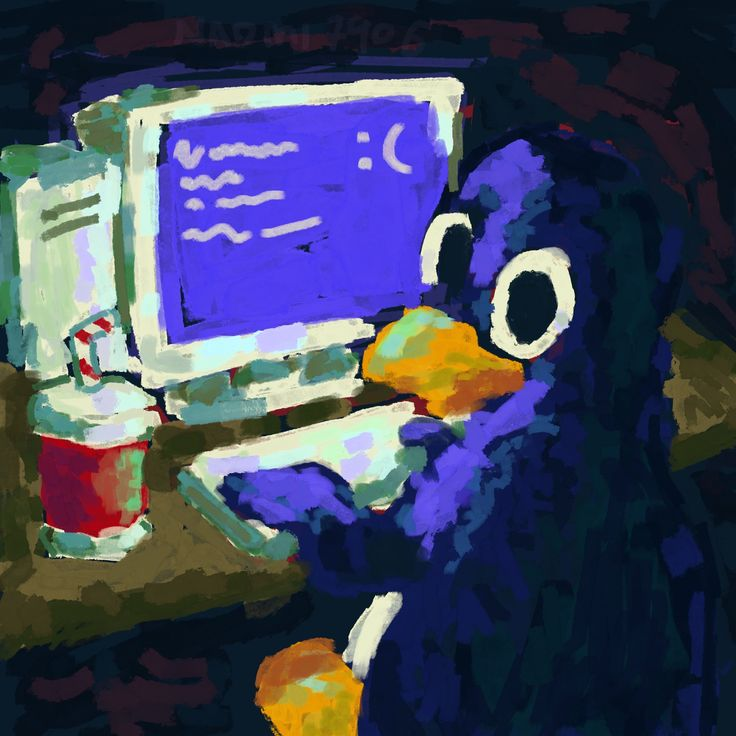

# Simulacros de PC de frontend web · 2026-2

Hay seis simulacros independientes. Cada uno tiene un enunciado de 14 puntos, un contrato HTTP y su propio backend Spring Boot.

En estos simulacros puedes consultar el código fuente del backend. **En la PC original recibirás un backend ya desplegado y la documentación de sus rutas. La evaluación consiste en implementar el frontend web que consume esa API.**

<p align="center">
  
</p>

## Elige un caso

| Servicio | Puerto | Material |
|---|---:|---|
| `espacios-estudio` | 3001 | [Reserva de espacios de estudio](casos/01-espacios-estudio/ENUNCIADO.md) · [API](casos/01-espacios-estudio/API.md) |
| `talleres-culturales` | 3002 | [Inscripción a talleres culturales](casos/02-talleres-culturales/ENUNCIADO.md) · [API](casos/02-talleres-culturales/API.md) |
| `mantenimiento-campus` | 3003 | [Reportes de mantenimiento del campus](casos/03-mantenimiento-campus/ENUNCIADO.md) · [API](casos/03-mantenimiento-campus/API.md) |
| `prestamo-juegos` | 3004 | [Préstamo de juegos de mesa](casos/04-prestamo-juegos/ENUNCIADO.md) · [API](casos/04-prestamo-juegos/API.md) |
| `entregas-reciclaje` | 3005 | [Registro de entregas para reciclaje](casos/05-entregas-reciclaje/ENUNCIADO.md) · [API](casos/05-entregas-reciclaje/API.md) |
| `solicitudes-tutoria` | 3006 | [Actualización de solicitudes de tutoría](casos/06-solicitudes-tutoria/ENUNCIADO.md) · [API](casos/06-solicitudes-tutoria/API.md) |

## Empieza con Docker

1. Instala Docker con Docker Compose.
2. Desde la raíz ejecuta `docker compose up --build espacios-estudio`.
3. Comprueba el arranque con `curl -f http://localhost:3001/api/health`.
4. Abre el enunciado y el contrato del caso en la tabla de arriba. Crea tu proyecto React con Vite en una carpeta separada del backend y ejecútalo en `http://localhost:5173`.

## Detén o restaura el backend

Puedes iniciar varios servicios en paralelo usando sus nombres. Para detener un caso usa `docker compose stop espacios-estudio`. Los datos persisten al detenerlo. Para restaurar solo ese caso ejecuta `bash scripts/restaurar-backend.sh espacios-estudio`. El comando borra sus cambios locales.

## Ejecuta con Java 21

Puedes levantar el backend con Maven Wrapper desde la terminal. Instala el **JDK 21** según tu sistema.

### Linux (Ubuntu)

```bash
sudo apt update
sudo apt install openjdk-21-jdk
```

Si ya tienes varias versiones de Java, selecciona la 21 con `sudo update-alternatives --config java`. Si `JAVA_HOME` apunta a otra versión, actualízalo para esta terminal.

```bash
export JAVA_HOME="$(dirname "$(dirname "$(readlink -f "$(command -v java)")")")"
```

[Paquete OpenJDK 21 para Ubuntu](https://packages.ubuntu.com/en/openjdk-21-jdk)

### macOS (Homebrew)

```bash
brew install openjdk@21
export JAVA_HOME="$(brew --prefix openjdk@21)/libexec/openjdk.jdk/Contents/Home"
export PATH="$JAVA_HOME/bin:$PATH"
```

Los cambios de `JAVA_HOME` y `PATH` se aplican a la terminal actual. [OpenJDK 21 en Homebrew](https://formulae.brew.sh/formula/openjdk@21)

### Inicia el backend

En Linux o macOS, desde la raíz del repo:

```bash
java -version
cd casos/01-espacios-estudio/backend
./mvnw spring-boot:run
```

Comprueba que `java -version` indique la versión 21. Para otro caso, usa su carpeta `backend/` y el puerto de la tabla. En Windows, con el JDK 21 instalado, ejecuta `mvnw.cmd spring-boot:run` desde la carpeta del backend.

Para restaurar los datos en este modo, detén la aplicación y elimina su carpeta local `data/`. Usa un solo modo de ejecución por caso. Si Vite usa otro origen, configura `FRONTEND_ORIGIN` al iniciar el backend.

<p align="center">
  
  
</p>
